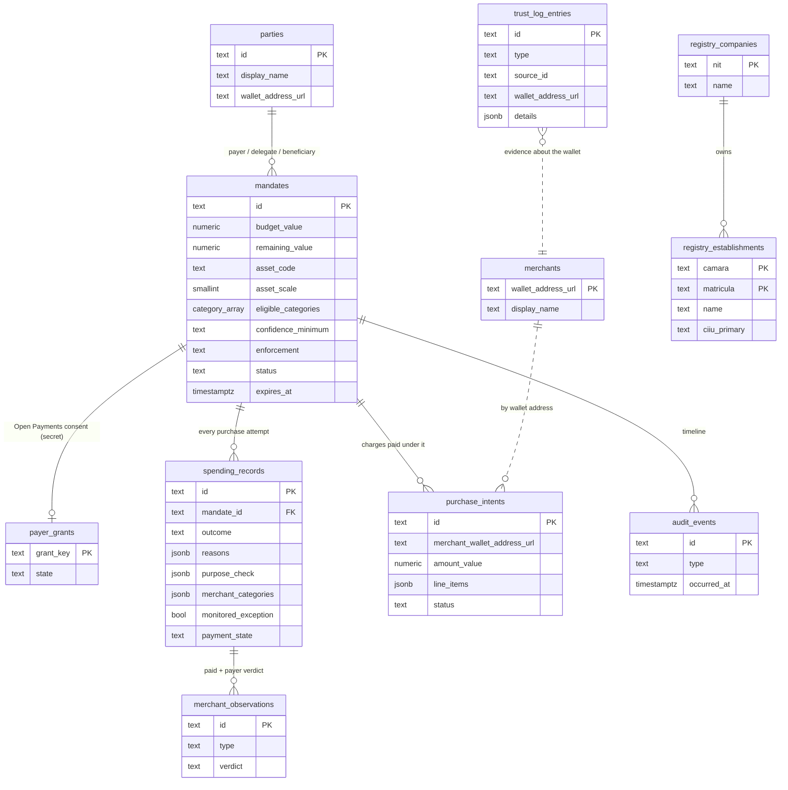

# Data model for the frontend

What the backend stores in Supabase, which screen each piece feeds, and the shape it reaches the browser in. The SQL is in [`data/migrations/`](../../data/migrations/) and the database rules in [`data/schema/README.md`](../../data/schema/README.md). This page is the frontend's view of them.

## The one rule

**The frontend never talks to Supabase.** The `compas` schema is closed to `anon` and `authenticated`, so the Supabase JS client and the anon key get nothing. The browser calls the backend over HTTP, and the backend reads and writes the database. A policy result (`ALLOW`, `DENY`, `REVIEW`) comes only from the backend.

## Diagram



## What each table feeds

| Table | Screen | What the user sees | Served by |
| --- | --- | --- | --- |
| `parties` | all | Pedro, Andrea, Gladys and their names | inside the mandate |
| `mandates` | ARQ (Pedro) | Budget, remaining amount, purpose, "allow even if not fully approved", expiry | not yet (`GET /mandates/:id`) |
| `payer_grants` | none | Nothing. Open Payments tokens are secrets | never |
| `merchants` | Nequi Negocios, Nequi | The shop's name | not yet |
| `purchase_intents` | Nequi Negocios → Nequi | The charge the shop creates and Andrea pays with the QR | not yet (`POST /purchase-intents`) |
| `spending_records` | ARQ (Pedro) | Where the budget went: each attempt, ALLOW/DENY/REVIEW, why, which categories the shop had | not yet. Shape: [`contracts/purchases/`](../purchases/README.md) |
| `merchant_observations` | ARQ (Pedro) | The "did this purchase fit?" answer (`MATCH`/`MISMATCH`) | `POST /spending-records/:id/confirmation` ([`contracts/merchant-history/`](../merchant-history/README.md)), not wired yet |
| `trust_log_entries` | Nequi Negocios, `/demo` | The shop's categories and how well they are backed | `GET /merchants/categories?walletAddress=…` ([`contracts/merchant-categories/`](../merchant-categories/README.md)) |
| `audit_events` | `/demo` | Decision timeline | not yet |
| `registry_*` | Nequi Negocios onboarding | The Cámara de Comercio record of a shop (1,900 real Medellín shops) | not yet |

Routes marked "not yet" are listed in [`backend/src/api/README.md`](../../backend/src/api/README.md). Ask the backend team before you depend on one. Never read the table instead.

## Formats

**Money** is never a float. It is always three fields:

```json
{ "value": "4000", "assetCode": "USD", "assetScale": 2 }
```

`value` is an integer string in minor units. This one is USD 40.00. Format it with `value / 10^assetScale`, using string or BigInt math, not `Number` arithmetic on large values. Pedro's budget and debit are in his wallet's asset. The shop's requested amount is in the shop's asset. COMPAS never converts between them; only an Open Payments quote does.

**Dates** are ISO 8601 strings in UTC (`2026-10-16T15:00:00.000Z`). Show them in Colombia time (UTC-5).

**Wallet addresses** are https URLs without a trailing slash, for example `https://ilp.interledger-test.dev/tiendita`.

## Values to handle

| Field | Values | Show it as |
| --- | --- | --- |
| Category | `MEDICATION`, `FOOD`, `PERSONAL_CARE`, `ALCOHOL`, `TOBACCO` | Medicamentos, Alimentos, Cuidado personal, Licor, Tabaco |
| Decision `outcome` | `ALLOW`, `DENY`, `REVIEW` | Aprobado, Rechazado, En revisión |
| Mandate `enforcement` | `ENFORCED`, `MONITORED` | MONITORED is Pedro's "allow even if not fully approved" tick |
| Mandate `status` | `DRAFT`, `PENDING_AUTHORIZATION`, `ACTIVE`, `EXHAUSTED`, `EXPIRED`, `REVOKED` | |
| Merchant confidence | `CONTESTED`, `LOW`, `MEDIUM`, `HIGH` | How sure COMPAS is that the shop sells that category |
| Trust level | `SELF_DECLARED`, `PROVIDER_VERIFIED`, `EXTERNAL_VERIFIED` | Who backs it: the shop itself, its wallet, or a registry such as the Cámara de Comercio |
| Payment state | `PENDING`, `COMPLETED`, `FAILED` | |
| Payer verdict | `MATCH`, `MISMATCH` | "Sí era para eso" / "No era para eso" |

Decision `reasons` carry a `code` and a `message`. Build the copy from the code. The list is `POLICY_REASON_CODES` in `backend/src/domain/policy-decision.ts`. The ones the demo shows:

- `PURPOSE_MISMATCH`, `MERCHANT_NOT_ELIGIBLE`: the shop doesn't fit the purpose (the liquor store).
- `BUDGET_EXCEEDED`: the debit is more than what is left.
- `PAYER_MONITORED_EXCEPTION`: paid only because Pedro ticked MONITORED. Flag it in his report.
- `MERCHANT_EVIDENCE_INSUFFICIENT`, `MERCHANT_EVIDENCE_CONFLICT`, `MERCHANT_HISTORY_CONTRADICTS`: the shop's evidence is too weak or contradicts itself.

## Never shown in the browser

- Open Payments grant tokens (`payer_grants`). The backend never returns them.
- HMAC refs (`subject_ref`, `payer_ref`, `delegate_ref`). The backend strips them from responses.
- A natural person's NIT or cédula. The registry doesn't store them.
- Line-item descriptions after a charge is decided. They can name a medicine. Show categories instead.

## Labels the demo must carry

- ARQ, Nequi and Nequi Negocios are simulations. Category evidence from them is labeled `demo/test data` (`dataLabel` and `simulated` in the category response).
- The Cámara de Comercio shops are real public records (Confecámaras RUES, CC BY-SA 4.0). Credit them as "Fuente: Confecámaras, RUES, datos.gov.co", and never show a real shop as suspicious.
