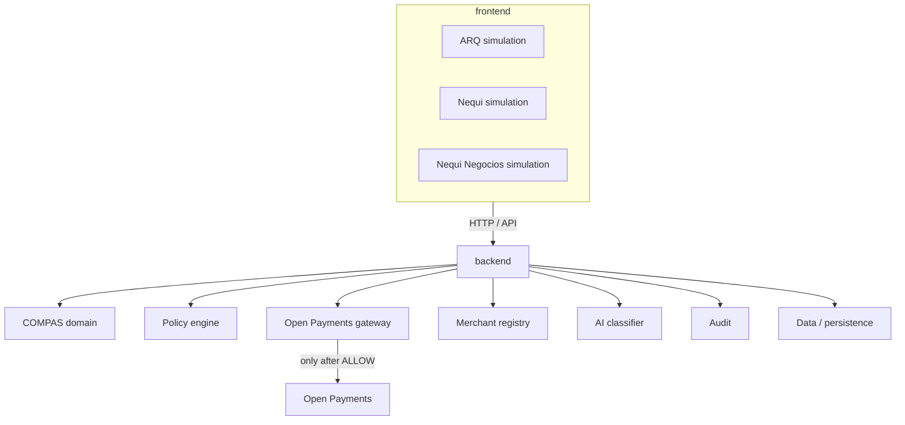
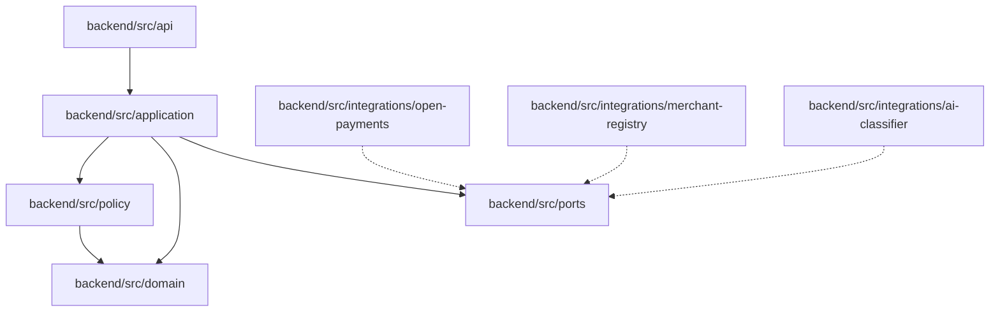
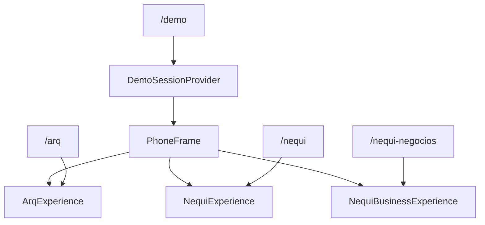
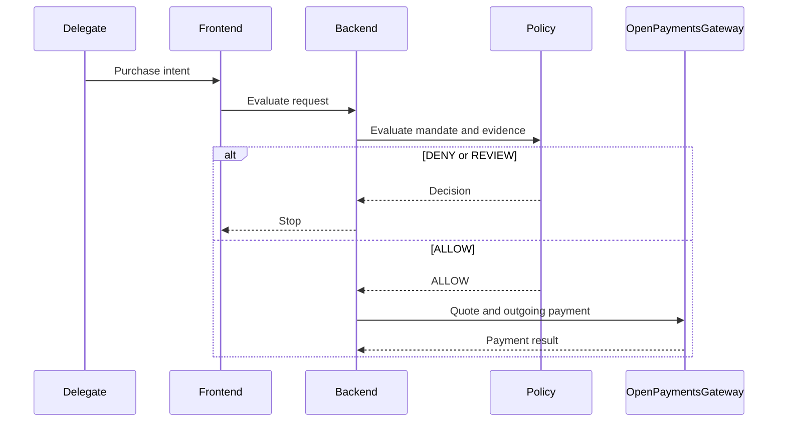

# Architecture

COMPAS is a product repository. The root is not an application. `frontend/`, `backend/`, and `data/` are separate. There is no npm workspace at the root. See [adr/0004-general-monorepo-architecture.md](adr/0004-general-monorepo-architecture.md).

The three wallet simulations remain one Next.js app inside `frontend/`. Domain code does not import Next.js, the Open Payments SDK, an AI vendor SDK, or a database client.

## System context

ARQ, Nequi, and Nequi Negocios are UX simulations inside the frontend. Open Payments is the payment layer. COMPAS never sits in the path as a custodian.

## Backend components

Ports:

- `OpenPaymentsGateway` — wallet resolution, grants, incoming payments, quotes, outgoing payments, payment status
- `MandateRepository`
- `MerchantRegistry`
- `PurposeClassifier`
- `AuditRepository`

The Open Payments adapter is real: `InterledgerOpenPaymentsGateway` in `backend/src/integrations/open-payments/`. It is used when `CLIENT_WALLET_ADDRESS`, `KEY_ID` and `PRIVATE_KEY_PATH` are set. Otherwise `UnimplementedOpenPaymentsGateway` throws. The other adapters still throw `NotImplementedError`. They do not return fake successes. Repository placeholders live in `backend/src/ports/unimplemented-repositories.ts` because there is no storage integration yet.

`createOutgoingPaymentIfAllowed` in `backend/src/application/create-outgoing-payment-if-allowed.ts` is the only payment-related behavior in the scaffold: `DENY` and `REVIEW` return before the gateway is called.

The frontend does not import these modules. It will call the backend over HTTP. `GET /health` and the Open Payments consent callback `GET /open-payments/finish` are the only routes today. The callback answers only with a redirect. Its shapes are in `contracts/open-payments/`.

## Three surfaces, one frontend

`/demo` renders the three experiences inside `PhoneFrame` under one `DemoSessionProvider`, so a scenario change is visible on every phone. The standalone routes use the same components with their own provider. There are no iframes and no second implementation of a surface.

Shared presentation for the identity card is `frontend/src/features/shared/ExperienceCard.tsx`. Each feature component still owns its surface, person, and role. Scenario content is read from `data/fixtures/demo/`.

## Policy, then payment

The gateway calls in that diagram are implemented. The orchestrator that makes them is not, and `npm run op:smoke` exercises the Open Payments leg alone. A decision rendered by the frontend is not authoritative.

Evaluation order is the constant `POLICY_EVALUATION_ORDER` in `backend/src/policy/evaluation-order.ts` and is explained in [05-policy-engine.md](05-policy-engine.md).

## Runtime

The frontend is Next.js 16.4 App Router, TypeScript, Tailwind CSS, and ESLint. `cacheComponents` and `partialPrefetching` stay on because that template requires them together.

The backend is a Node.js TypeScript process with a small `node:http` server. It has no web framework yet.

No database is selected. Persistence, when it exists, belongs under `data/` and behind backend repositories.
