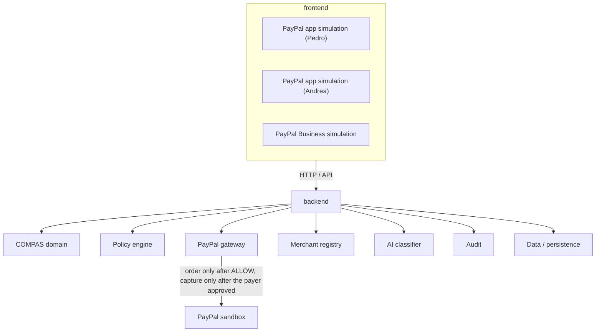
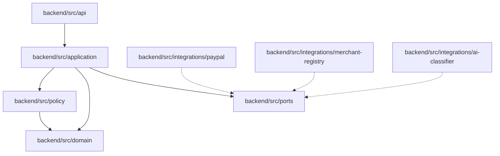
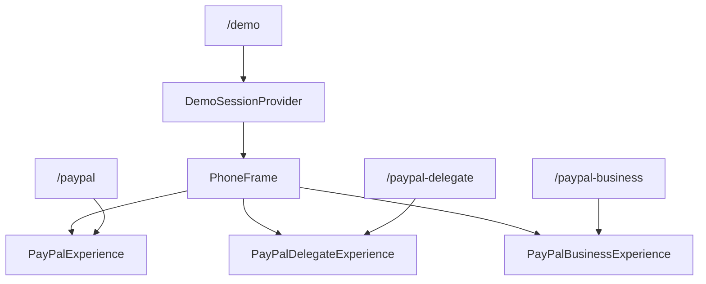
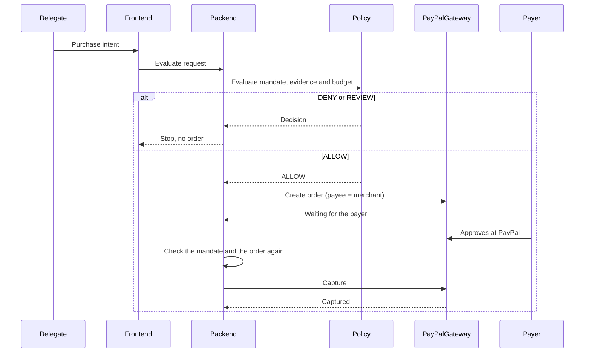

# Architecture

COMPAS is a product repository. The root is not an application. `frontend/`, `backend/`, and `data/` are separate. There is no npm workspace at the root. See [adr/0004-general-monorepo-architecture.md](adr/0004-general-monorepo-architecture.md).

The three wallet simulations remain one Next.js app inside `frontend/`. Domain code does not import Next.js, a PayPal client, an AI vendor SDK, or a database client.

## System context

The PayPal app screens (Pedro's and Andrea's) and the PayPal Business screen are UX simulations inside the frontend. The PayPal Business screen's payments are not: the backend reads each COMPAS order to the merchant from the PayPal sandbox (`getOrder` only). The PayPal REST API, in the sandbox, is the payment layer. COMPAS never sits in the path as a custodian.

## Backend components

Ports:

- `PayPalGateway` — create, read and capture a PayPal order
- `MandateRepository`
- `SpendingLog` — every attempt, and the PayPal order's state as it moves
- `MerchantRegistry` — resolves a PayPal merchant id to COMPAS categories and trust levels
- `MerchantTrustLog`, `CategorySourceRegistry`, `CategoryMappingRepository`, `CategoryEvidenceFeed` — the merchant category service (see [ADR 0005](adr/0005-merchant-category-attestations.md))
- `PurposeClassifier`
- `AuditRepository`

The PayPal adapter is real: `PayPalRestGateway` in `backend/src/integrations/paypal/`, on the sandbox only. It is used when `PAYPAL_CLIENT_ID` and `PAYPAL_CLIENT_SECRET` are set. Otherwise `UnimplementedPayPalGateway` throws. The merchant category service is real but in memory: `TrustLogMerchantRegistry` with `InMemoryTrustLog`, seeded with simulated wallet KYB evidence. Its RUES and health-registry feeds throw. The other adapters still throw `NotImplementedError`. They do not return fake successes. Repository placeholders live in `backend/src/ports/unimplemented-repositories.ts` because there is no storage integration yet.

Two functions guard money. `createPayPalOrderIfAllowed` in `backend/src/application/create-paypal-order-if-allowed.ts` returns before the gateway for `DENY` and `REVIEW`. `PayPalOrderSettlement` in `backend/src/application/settle-paypal-order.ts` is the only caller of `captureOrder`, and it checks the mandate and the order again first. See [ADR 0008](adr/0008-paypal-rail-per-order-approval.md).

The frontend does not import these modules. It calls the backend over HTTP, through the `/compas-api/*` rewrite in `frontend/next.config.ts`. Routes today: `GET /health`, the PayPal return and cancel redirects `GET /paypal/orders/return` and `GET /paypal/orders/cancel`, the merchant category routes `POST /merchant-category-claims`, `GET /merchants/categories` and `GET /demo/merchants`, the merchant's sandbox payments `GET /demo/merchants/:id/payments`, the mandate routes (demo sessions, `/me`, `/mandates…`) and the delegate's purchase routes `POST /purchases/preview` and `POST /purchases`. The PayPal redirects answer only with a redirect to the frontend, after the settlement captured or closed the order. `POST /purchases` runs `purchaseUnderMandate` and is off for demo sessions unless the operator sets `COMPAS_DEMO_PURCHASES=enabled`. Shapes are in `contracts/merchant-categories/`, `contracts/mandates/` and `contracts/purchases/`. Mandates are in Postgres with `DATABASE_URL`, in memory without it. The COMPAS experience is described in [plans/compas-experience.md](plans/compas-experience.md).

## Three surfaces, one frontend

`/demo` renders the three experiences inside `PhoneFrame` under one `DemoSessionProvider`, so a scenario change is visible on every phone. The standalone routes use the same components with their own provider. There are no iframes and no second implementation of a surface.

Shared presentation for the identity card is `frontend/src/features/shared/ExperienceCard.tsx`. Each feature component still owns its surface, person, and role. Scenario content is read from `data/fixtures/demo/`.

## Policy, then payment

The gateway calls in that diagram are implemented. `purchaseUnderMandate` creates the order, behind `POST /purchases`, and `PayPalOrderSettlement` captures it, behind the PayPal return route. `npm run paypal:smoke` exercises the PayPal leg alone. A decision rendered by the frontend is not authoritative.

Evaluation order is the constant `POLICY_EVALUATION_ORDER` in `backend/src/policy/evaluation-order.ts` and is explained in [05-policy-engine.md](05-policy-engine.md).

## Runtime

The frontend is Next.js 16.4 App Router, TypeScript, Tailwind CSS, and ESLint. `cacheComponents` and `partialPrefetching` stay on because that template requires them together.

The backend is a Node.js TypeScript process with a small `node:http` server. It has no web framework yet.

Persistence is Supabase Postgres when `DATABASE_URL` is set: schema in `data/migrations/`, adapters in `backend/src/integrations/postgres/`, behind the backend's ports. Without it, every repository is in memory.
