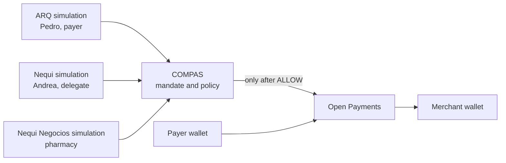
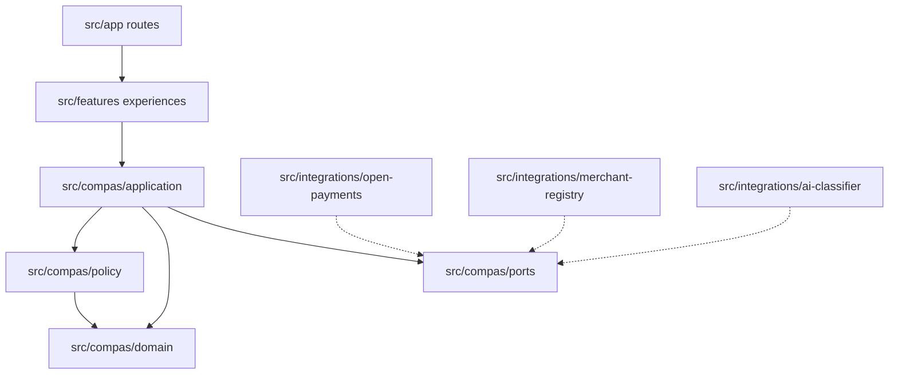
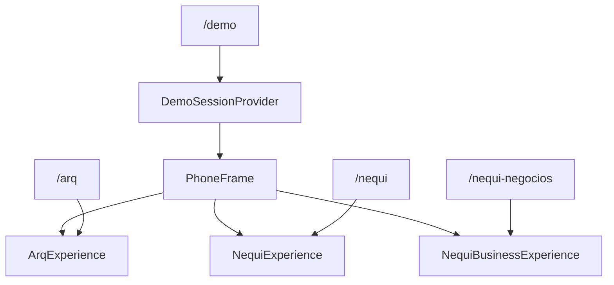
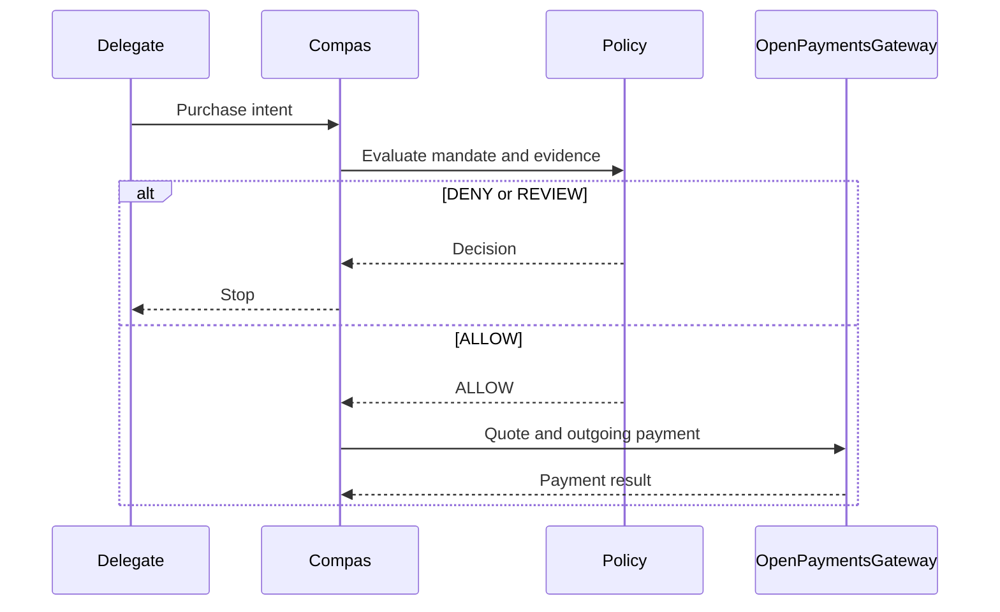

# Architecture

COMPAS is one Next.js application. It is not a monorepo and not three apps. Domain code does not import Next.js, the Open Payments SDK, an AI vendor SDK, or a database client.

## System context

The three surfaces are UX simulations. Open Payments is the payment layer. COMPAS never sits in the path as a custodian.

## Components

Ports:

- `OpenPaymentsGateway` — wallet resolution, grants, incoming payments, quotes, outgoing payments, payment status
- `MandateRepository`
- `MerchantRegistry`
- `PurposeClassifier`
- `AuditRepository`

Current adapters throw `NotImplementedError`. They do not return fake successes. Repository placeholders live in `src/compas/ports/unimplemented-repositories.ts` because there is no storage integration yet.

`createOutgoingPaymentIfAllowed` in `src/compas/application/create-outgoing-payment-if-allowed.ts` is the only payment-related behavior in the scaffold: `DENY` and `REVIEW` return before the gateway is called.

## Three surfaces, one demo

`/demo` renders the three experiences inside `PhoneFrame` under one `DemoSessionProvider`, so a scenario change is visible on every phone. The standalone routes use the same components with their own provider. There are no iframes and no second implementation of a surface.

Shared presentation for the identity card is `src/features/shared/ExperienceCard.tsx`. Each feature component still owns its surface, person, and role.

## Policy, then payment

The gateway call in that diagram is future behavior. The unimplemented gateway rejects every call today.

Evaluation order is the constant `POLICY_EVALUATION_ORDER` in `src/compas/policy/evaluation-order.ts` and is explained in [05-policy-engine.md](05-policy-engine.md).

## Runtime

The app is Next.js 16.4 App Router, TypeScript, Tailwind CSS, and ESLint, as generated for the current stable `create-next-app` empty template. `cacheComponents` and `partialPrefetching` stay on because that template requires them together. No extra UI or data libraries were added.

Deployment to Vercel is possible later and is not part of this scaffold.
