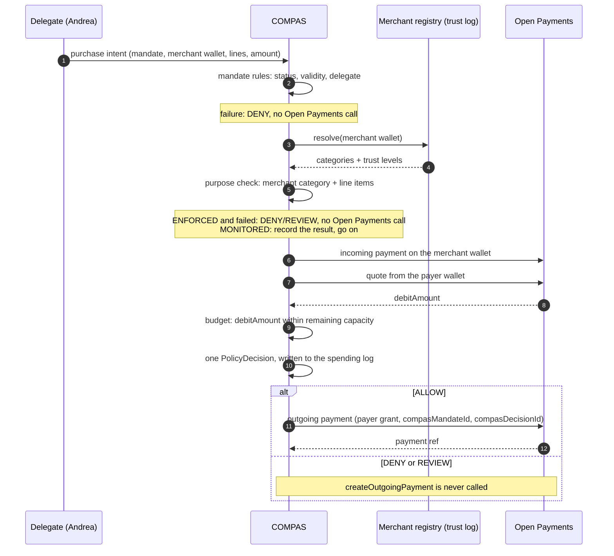

# Open Payments mapping

Open Payments and COMPAS are different layers.

Open Payments moves value between wallet addresses. It speaks grants, access actions, and limits. COMPAS decides whether a delegate may cause a payment for a purpose. `MEDICATION` is not an Open Payments scope.

`OpenPaymentsGateway` in `backend/src/ports/open-payments-gateway.ts` is the port. The real adapter is `backend/src/integrations/open-payments/`. It is the only code that imports the Interledger SDK (`@interledger/open-payments` 7.4.0). The frontend does not hold the client key. The plan and the handoff contract for the orchestrator are in [plans/open-payments-integration.md](plans/open-payments-integration.md).

## Who enforces what

| Concern | Owner |
| --- | --- |
| Wallet address, auth server, resource server | Open Payments |
| Grant, access actions, continuation | Open Payments |
| Monetary and interval limits on a grant | Open Payments |
| Incoming payment, quote, outgoing payment, completion | Open Payments |
| Mandate, payer, delegate, beneficiary | COMPAS |
| Purpose and eligible category | COMPAS |
| Merchant evidence and trust level | COMPAS |
| Line-item purpose policy | COMPAS |
| AI category suggestion | COMPAS classifier, then the policy engine |
| Decision reason and audit trail | COMPAS |

Open Payments can already say "at most this much, over this interval." COMPAS adds "only for this purpose, by this delegate, for this beneficiary."

## How COMPAS sits on top of Open Payments

COMPAS is a decision layer in front of one Open Payments call. It never holds money. One purchase runs through `purchaseUnderMandate` in `backend/src/application/purchase-under-mandate.ts`:

What each layer guarantees:

| Layer | Guarantees | Can't do |
| --- | --- | --- |
| Open Payments grant | The payer consented once at their own wallet. Debits never exceed `limits.debitAmount`. | Know the purpose, the delegate or the merchant's category |
| COMPAS mandate rules | Only the named delegate, while the mandate is active and in its window, within the remaining budget | Move money |
| COMPAS purpose checks | The merchant's category (from the trust log) and the line items fit the purpose | Bypass the grant cap |
| COMPAS spending log | The payer sees every attempt: merchant, categories, match, decision, payment | Change a past decision |

### The payer's tick: ENFORCED or MONITORED

When the payer sets up a budget, they pick `purposePolicy.enforcement` ([ADR 0006](adr/0006-monitored-budgets.md)):

| Purpose check | `ENFORCED` | `MONITORED` (tick on) |
| --- | --- | --- |
| Passes | `ALLOW` | `ALLOW` |
| Weak or conflicting evidence | `REVIEW`, not paid | `ALLOW`, flagged `PAYER_MONITORED_EXCEPTION` |
| Merchant or line outside the purpose | `DENY`, not paid | `ALLOW`, flagged `PAYER_MONITORED_EXCEPTION` |
| Mandate rule or budget fails | `DENY` | `DENY` |

In both modes, policy returns `ALLOW` before any outgoing payment, and the Open Payments grant cap still applies. `MONITORED` changes what the purpose check decides, not who decides: the rule is the payer's, set in advance, and deterministic.

`buildSpendingReport` (`backend/src/application/spending-report.ts`) gives the payer's view. It shows totals paid, paid outside the purpose, and monitored exceptions, plus every attempt with its merchant categories and Open Payments references. The payload is in `contracts/purchases/README.md`.

## Concept map

| COMPAS | Open Payments |
| --- | --- |
| Payer wallet | Wallet address that will be debited |
| Merchant wallet | Wallet address that receives an incoming payment |
| Delegate | Not a wallet role. The delegate is outside Open Payments. |
| Beneficiary | Not a payee. Gladys may have no wallet address. |
| Budget and remaining capacity | May later be reflected by an outgoing-payment grant `debitAmount` limit. The COMPAS figure is still authorization capacity, not custody. |
| Validity window | May later align with a grant interval. Purpose expiry remains a COMPAS rule. |
| Purpose policy | No Open Payments equivalent. Do not encode it as a scope. |
| Policy decision id | Opaque `compasDecisionId` metadata, if metadata is sent at all |
| Mandate id | Opaque `compasMandateId` metadata |

## Resources

**Wallet address.** A URL that publishes account discovery data, including the authorization server and resource server. COMPAS will resolve payer and merchant addresses through the gateway. It does not invent them in the domain model.

**Grant.** GNAP-style permission for actions on a resource. An outgoing-payment grant is taken on the payer's wallet. Its limits can cap the debit amount and the interval. The final receiver does not have to be known when that grant is requested. Pedro can authorize a spending budget before Andrea chooses an eligible pharmacy. The receiver appears later, when an incoming payment and a quote exist.

The gateway requests that grant with `startPayerGrant`: `outgoing-payment` access, `limits.debitAmount` set to the mandate budget, no `receiver`, and interactive redirect consent. Pedro's wallet then redirects to `GET /open-payments/finish`. The backend checks the finish `hash` and calls `grant.continue`. Tokens stay in the backend `GrantStore`. Callers refer to the grant by the mandate id. Incoming-payment and quote grants are non-interactive, and COMPAS requests them as a client.

**Incoming payment.** Created on the receiver's resource server. The receiver is the merchant, not Andrea.

**Quote.** Prices a payment from the payer's asset into the incoming payment. For a USD payer wallet and a COP merchant wallet, the quote is where exchange and cost information belong. Use a value returned by the Open Payments test environment, or a fixture explicitly marked `demo/test data`. Do not hardcode a rate and present it as live.

**Outgoing payment.** Executes the quoted payment from the payer's wallet. COMPAS may call `createOutgoingPayment` only after policy evaluation returns `ALLOW`. Open Payments has no status field on an outgoing payment. It reports `failed`, `debitAmount` and `sentAmount`, and COMPAS derives `PENDING`, `COMPLETED` or `FAILED` from them. The merchant's incoming payment (`readIncomingPayment`) gives the receiver-side view.

Open Payments currently uses ILP as its directly integrated payment method. This prototype does not integrate Nequi, ARQ, Daviplata, Bre-B, or ACH. Those names in the UI are simulated embedding surfaces.

## Client configuration

The authenticated client follows the official Node snippets for `createAuthenticatedClient`:

- `walletAddressUrl` from `CLIENT_WALLET_ADDRESS`
- `keyId` from `KEY_ID`
- `privateKey` from `PRIVATE_KEY_PATH` (a path or key contents)

Those names are in `backend/.env.example`. No credentials are filled in. The private key file must stay out of git and must not be exposed to the frontend. If any of the three is missing, the backend keeps `UnimplementedOpenPaymentsGateway`, which throws on every call.

`CLIENT_WALLET_ADDRESS` is COMPAS's own wallet address. It identifies COMPAS as a client and is never debited. Pedro's wallet and the merchant's wallet are separate addresses.

`npm run op:smoke` in `backend/` runs one real payment on the test network, from consent to completion. It uses `DEMO_PAYER_WALLET_ADDRESS` and `DEMO_MERCHANT_WALLET_ADDRESS`. It runs no COMPAS policy.

`npm run compas:smoke` runs the same network with COMPAS on top: merchant categories, the purchase policy in `ENFORCED` or `MONITORED` mode, the gated outgoing payment and the payer's spending report. See `backend/README.md`.

## Metadata

Open Payments accepts metadata on a payment. COMPAS sends only the following keys. `toSafeMetadata` in the adapter drops any other key before the request is made:

- `compasMandateId`
- `compasDecisionId`
- `externalReference`

Do not send a diagnosis, a drug name, a national ID, or other health or identity detail in that metadata. The audit trail can hold richer operational history inside COMPAS, still without unnecessary sensitive data.
