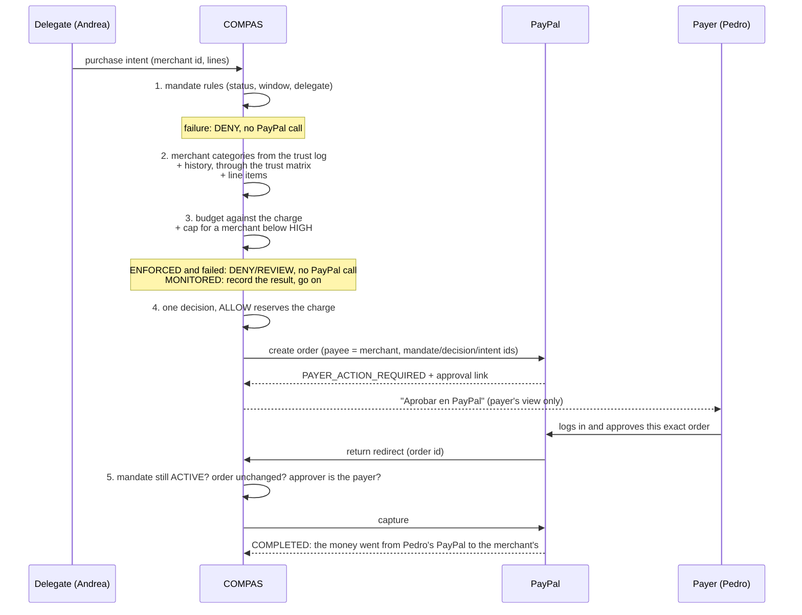

# PayPal mapping

PayPal and COMPAS are different layers.

PayPal moves money from the payer's PayPal account to the merchant's, and the payer approves each payment at PayPal. COMPAS decides whether a delegate may cause a payment for a purpose. `MEDICATION` is a COMPAS category, not a PayPal concept. The decision behind this design is [ADR 0008](adr/0008-paypal-rail-per-order-approval.md).

`PayPalGateway` in `backend/src/ports/paypal-gateway.ts` is the port. The REST adapter is `backend/src/integrations/paypal/`. It is the only code that talks to PayPal, over `fetch`, and it runs on the sandbox only (`https://api-m.sandbox.paypal.com`).

## Who owns what

| Concern | Owner |
| --- | --- |
| PayPal accounts, login, funding source, currency conversion for the payer | PayPal |
| The order, the payer's approval, the capture | PayPal |
| Mandate, delegate, beneficiary | COMPAS |
| Budget, remaining capacity, per-order cap below `HIGH` | COMPAS |
| Purpose, eligible categories, merchant confidence | COMPAS |
| `ALLOW`, `DENY`, `REVIEW` | COMPAS |
| Audit and spending trail | COMPAS |

PayPal shows Pedro the amount and the merchant of every payment, and nothing moves until he approves it. COMPAS adds "only for this purpose, by this delegate, for this beneficiary, within this budget."

## How COMPAS sits on top of PayPal

COMPAS is a decision layer in front of one PayPal order. It never holds money. One purchase runs through `purchaseUnderMandate` in `backend/src/application/purchase-under-mandate.ts`, and its payment through `PayPalOrderSettlement` in `backend/src/application/settle-paypal-order.ts`:

What each layer guarantees:

| Layer | Guarantees | Can't do |
| --- | --- | --- |
| PayPal approval | The payer approved this exact order, logged in to their PayPal. PayPal pays the payee directly. | Know the purpose, the delegate or the merchant's category |
| COMPAS mandate rules | Only the named delegate, while the mandate is active and in its window, within the remaining budget | Move money |
| COMPAS purpose checks | The merchant's category (from the trust log) and the line items fit the purpose | Make the payer approve |
| COMPAS settlement | Capture only an approved order that still matches, under a mandate still usable | Capture what the payer did not approve |
| COMPAS spending log | The payer sees every attempt: merchant, categories, match, decision, PayPal state | Change a past decision |

Nothing in PayPal caps the spend for COMPAS: there is no equivalent of an Open Payments `debitAmount`. The budget is a COMPAS rule, enforced before the order exists and reserved atomically, and the payer's approval of every order bounds a COMPAS bug.

### The payer's tick: ENFORCED or MONITORED

When the payer sets up a budget, they pick `purposePolicy.enforcement` ([ADR 0006](adr/0006-monitored-budgets.md)):

| Purpose check | `ENFORCED` | `MONITORED` (tick on) |
| --- | --- | --- |
| Passes | `ALLOW` | `ALLOW` |
| Weak or conflicting evidence | `REVIEW`, no order | `ALLOW`, flagged `PAYER_MONITORED_EXCEPTION` |
| Merchant or line outside the purpose | `DENY`, no order | `ALLOW`, flagged `PAYER_MONITORED_EXCEPTION` |
| Mandate rule or budget fails | `DENY` | `DENY` |

In both modes, policy returns `ALLOW` before any PayPal order, and the payer still approves every order. `MONITORED` changes what the purpose check decides, not who decides: the rule is the payer's, set in advance, and deterministic.

`buildSpendingReport` (`backend/src/application/spending-report.ts`) gives the payer's view: totals paid, paid outside the purpose and monitored exceptions, plus every attempt with its merchant categories and PayPal state. The payload is in `contracts/purchases/README.md`.

## Concept map

| COMPAS | PayPal |
| --- | --- |
| Payer | The PayPal account that approves the order. `DEMO_PAYER_PAYPAL_ID`, when set, pins it. |
| Merchant | The order's payee, by `payee.merchant_id` |
| Delegate | Not a PayPal role. Andrea is outside PayPal. |
| Beneficiary | Not a payee. Gladys needs no PayPal account. |
| Budget and remaining capacity | No PayPal equivalent. COMPAS's authorization capacity, not custody. |
| Validity window | No PayPal equivalent. The settlement refuses to capture outside it. |
| Purpose policy | No PayPal equivalent. |
| Policy decision id | `custom_id`, and the order's `PayPal-Request-Id` |
| Mandate id | `reference_id` |
| Purchase intent id | `invoice_id` |

## Resources

**Order (`POST /v2/checkout/orders`).** `intent: CAPTURE`, one purchase unit for exactly the charge, payable to `payee.merchant_id`, with `payment_source.paypal.experience_context` set to COMPAS's return and cancel URLs, `user_action: PAY_NOW` and `shipping_preference: NO_SHIPPING`. No `brand_name`: PayPal shows the payer the merchant's own name. Lines are "Item 1", "Item 2". The answer is `PAYER_ACTION_REQUIRED` with a `payer-action` link, which COMPAS shows to the payer only, and only if it is an https page on `paypal.com`. `PayPal-Request-Id` is the decision id, so a retry returns the same order.

**Approval.** The payer opens the link, logs in to PayPal and approves. PayPal sends the browser to `GET /paypal/orders/return?token=<order id>`, or `GET /paypal/orders/cancel?token=…`. Nothing in that URL is trusted.

**Capture (`POST /v2/checkout/orders/{id}/capture`).** Only the settlement calls it, after it read the order back (`GET`) and checked it. `PayPal-Request-Id` is `<decision id>-capture`, so a retried return never pays twice. The capture's status gives COMPAS's state: `COMPLETED`, `PENDING`, or `FAILED` with `CAPTURE_DECLINED`.

**Reconciliation.** Reading a mandate's activity reconciles its open orders: an approved order whose return never reached COMPAS is captured, one PayPal no longer knows (`404`) or voided is closed `ORDER_EXPIRED`, and a pending capture is read again.

**Payment states** (COMPAS's, on the spending record): `AWAITING_PAYER_APPROVAL`, `PENDING`, `COMPLETED`, `CANCELLED`, `FAILED` with a failure code (`MANDATE_NOT_USABLE`, `ORDER_MISMATCH`, `PAYER_ACCOUNT_MISMATCH`, `CAPTURE_DECLINED`, `ORDER_EXPIRED`). Only `COMPLETED` is money at the merchant.

**Currency.** The order is in the charge's currency, which must be the budget's: COMPAS does not convert. PayPal handles the payer's funding currency at approval. A budget in a currency PayPal doesn't take, such as COP, is refused when it is created.

This prototype does not integrate Nequi, Daviplata, Bre-B or ACH. Those names in the UI, and the PayPal app screens, are simulated embedding surfaces. The PayPal orders, approvals and captures are real sandbox calls.

## Client configuration

The adapter authenticates with OAuth client credentials (`POST /v1/oauth2/token`), from `PAYPAL_CLIENT_ID` and `PAYPAL_CLIENT_SECRET` in `backend/.env.example`. The token is kept in memory, renewed before it expires, and renewed once on a `401`. Neither the secret nor the token is logged, returned or put in an error. Without the credentials, the backend keeps `UnimplementedPayPalGateway`, which throws on every call.

`PAYPAL_ENVIRONMENT` is empty or `sandbox`. Any other value stops the backend at startup.

`DEMO_MERCHANT_PAYPAL_ID` is the pharmacy's sandbox business account: the payee of every pharmacy order. Use a business account other than the one that owns the app, or COMPAS's own account would receive the money. `DEMO_PAYER_PAYPAL_ID` optionally pins Pedro's sandbox personal account.

`npm run paypal:smoke` in `backend/` runs one real sandbox payment: order, approval in the browser, capture. It runs no COMPAS policy.

`npm run compas:smoke` runs COMPAS on top: merchant categories, the purchase policy in `ENFORCED` or `MONITORED` mode, the gated order, the approval, the settlement and the payer's spending report. See `backend/README.md`.

## Metadata

COMPAS sends PayPal only these references:

- `compasMandateId` as `reference_id`
- `compasDecisionId` as `custom_id`
- `externalReference` (the purchase intent id) as `invoice_id`

Do not send a diagnosis, a drug name, a national ID, or other health or identity detail to PayPal. The audit trail can hold richer operational history inside COMPAS, still without unnecessary sensitive data.
