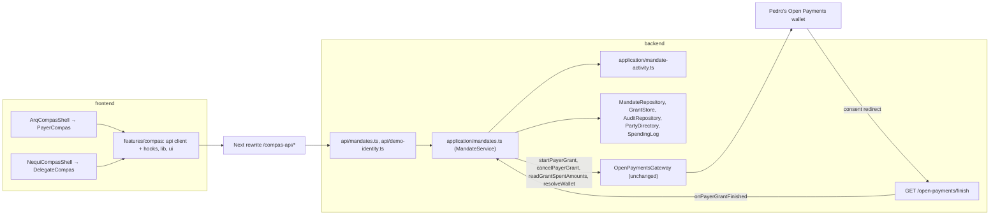
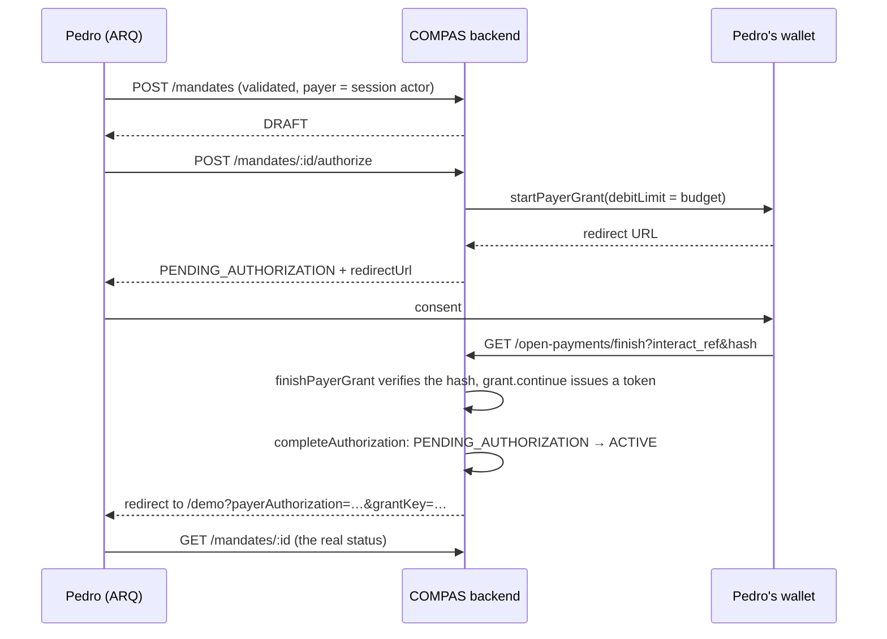

# COMPAS experience: budgets, authorizations and revocation

Branch `feature/compas-experience`, based on `open-payments` at `8a1aa24`. This is the first working COMPAS module inside the ARQ (payer) and Nequi (delegate) simulations. It covers mandates, consent and revocation. It does not cover purchases, merchant charges or QR payments.

## What a person can do

**Pedro, in ARQ.** Open COMPAS from `Otras formas de pago`. See his budgets, active capacity and recent activity. Create a budget in five steps: who pays and for whom, purpose, amount and window, rules and merchant confidence, review. "Crear y autorizar presupuesto" saves a `DRAFT`, asks his wallet for an outgoing-payment grant and sends him to its consent screen. Back in ARQ, the budget shows its real status. He can retry a rejected or failed authorization, read the rules and the activity, and revoke.

**Andrea, in Nequi.** Open COMPAS from `Sugeridos Nequi`. See the authorizations she received, active first. Read who granted each, for whom, the categories, remaining capacity, window, mode, accepted merchants and status. She can't revoke or change anything. "Pagar con COMPAS" says plainly that paying needs the merchant charge flow, which isn't connected yet. No button pretends to pay.

The same mandate appears for both from one backend. Neither app copies it.

## Architecture

- **One service, roles from the mandate.** `MandateService` decides who may see or act on a mandate from the actor's relation in it: payer, delegate or neither. ARQ and Nequi are where the demo people happen to be. They are not roles. A test has Andrea as the payer of her own mandate.
- **The gateway is reused, not duplicated.** No SDK call was added. `startPayerGrant` asks for an outgoing-payment grant capped at the budget, with no receiver and no interval. `cancelPayerGrant` revokes it. `readGrantSpentAmounts` gives the wallet's own spent figure. `resolveWallet` gives the payer wallet's asset.
- **The frontend decides nothing.** It renders views, words the backend's codes in Spanish, and does UX-only input checks. The backend validates everything again. No financial rule lives in React.
- **Shared components, host themes.** `features/compas/ui` reads `--cx-*` custom properties that each host sets (`features/compas/theme.ts`): ARQ green for ARQ, Nequi plum for Nequi. `--cx-route` is COMPAS magenta in both: the line that draws authorized capacity, never a balance.
- **No CORS, no public backend URL.** `next.config.ts` rewrites `/compas-api/*` to `COMPAS_BACKEND_URL` (default `http://localhost:4000`), a server-side variable.

## Flows

### Create and authorize

- The mandate becomes `ACTIVE` only in `completeAuthorization`. It runs only from the finish callback after `finishPayerGrant` succeeded, so the interaction hash matched the stored nonces and the auth server issued an access token. A forged callback fails the hash check and changes nothing. `payerAuthorization=granted` in the return URL only makes ARQ open that budget. The screen then reads the status.
- A rejected or failed consent leaves `PENDING_AUTHORIZATION`. Pedro can retry. The rejection is not recorded from the URL, because that query is unauthenticated.
- Without Open Payments configured, or without `DEMO_PAYER_WALLET_ADDRESS`, authorizing fails closed. The mandate stays a `DRAFT` and the screen says why.

### Revoke

`POST /mandates/:id/revoke` saves `REVOKED` first, so COMPAS blocks new purchases at once. Then it calls `cancelPayerGrant`. If the wallet can't be reached, the answer is `202` with `grantCancellation: "PENDING"`. ARQ shows "Revocado, falta confirmar en tu billetera" and a retry button, never "revocado" as if the provider had confirmed. A grant that finishes after a revocation is cancelled, not activated. Changing an active budget is not offered: it would need a new grant.

### Read as the delegate

`GET /mandates?role=delegate` lists only consented mandates: `ACTIVE`, `EXHAUSTED`, `EXPIRED`, `REVOKED`. A draft or a budget waiting for Pedro is not a permission yet, so Andrea sees nothing, and `GET /mandates/:id` answers `404`. Nequi polls every five seconds while COMPAS is open, so a revocation in ARQ shows in Nequi within seconds.

## Mandate states on screen

| Status | ARQ label | What the capacity line says |
| --- | --- | --- |
| `DRAFT` | Borrador | "Monto por autorizar". Nothing drawn as available |
| `PENDING_AUTHORIZATION` | Esperando autorización | "Monto por autorizar" |
| `ACTIVE` | Activo | "Capacidad autorizada disponible", solid magenta |
| `EXHAUSTED` | Agotado | "Capacidad agotada" |
| `EXPIRED` | Vencido | "Venció sin usar", or "sin autorizarse" for a draft |
| `REVOKED` | Revocado (or "falta confirmar en tu billetera") | "Revocado sin usar", or "Descartado sin autorizarse" |

Expiry and exhaustion are applied when a mandate is read. An expired mandate's grant isn't cancelled automatically. Revoking it does that.

## Activity and financial precision

`buildMandateActivity` reads the same spending log as `buildSpendingReport`, with these rules:

- **Paid** is only `COMPLETED`: the outgoing payment reached its debit amount.
- **In process** (`PENDING`) is kept apart and labeled "por confirmar".
- **Failed, denied and held** attempts add nothing. Their amounts are shown as "solicitado" or "no completado", and struck through.
- **Totals** use the quoted `debitAmount` in the budget's asset. Other assets are counted apart, never converted. Nothing is counted twice.

`buildSpendingReport`'s `totals.paid` counts any record with an outgoing payment URL, pending included. A test documents that difference. The report is unchanged because `compas:smoke` uses it.

Reason codes are worded in Spanish (`frontend/src/features/compas/lib/labels.ts`), for example `MERCHANT_NOT_ELIGIBLE`, "El comercio no cumple las categorías permitidas". The codes stay the backend's. Entries carry no line items, so no medicine name reaches a screen.

`purchaseUnderMandate` reserves the quoted debit from `remainingAuthorizedAmount` before it records an `ALLOW`, and releases it if the payment can't be created. If recorded debits ever exceed what the capacity accounts for, the activity says `capacityReconciled: false`, and ARQ shows a warning instead of presenting the figure as reconciled.

## Persistence

Since the merge with `main` (`docs/plans/compas-experience-integration.md`), `MandateService` uses the same storage as the rest of the backend:

| Port | With `DATABASE_URL` | Without |
| --- | --- | --- |
| `MandateRepository` | `compas.mandates` (`listByPayer` and `listByDelegate` filter `payer_id` and `delegate_id`) | `InMemoryMandateRepository` |
| `GrantStore` | `compas.payer_grants`, shared with the Open Payments gateway | `InMemoryGrantStore`, the same instance as the gateway's |
| `AuditRepository` | `compas.audit_events` | `InMemoryAuditRepository` |
| `SpendingLog` | `compas.spending_records` | `InMemorySpendingLog` |
| `PartyDirectory` | The demo parties in code (`demo-party-directory.ts`) | The same |

`/health` and `/me` say `persistence: "POSTGRES"` or `"IN_MEMORY_DEMO"`, and every COMPAS screen shows a demo-mode note. Without a database, a backend restart loses mandates, grants, the spending log and the trust log.

There is no separate authorization record. `consent` and `grantCancellation` are derived from the mandate's grant and its audit events. No migration was written and the schema wasn't changed.

The demo tienda's 12 `demo-food-mandate-N` mandates belong to `demo-food-payer-N` (`contracts/data-model/README.md`). Pedro's lists filter by `payer_id`, so they never show those mandates.

## Demo mode and its limits

- **Identity.** `POST /demo/sessions` hands any caller a session as Pedro, Andrea or Gladys. The browser never sends a trusted party id. The backend resolves the actor from an opaque token. It's off with `NODE_ENV=production` or `COMPAS_DEMO_IDENTITY=disabled`. A demo session can't ask a wallet for a grant unless the operator sets `COMPAS_DEMO_PAYER_GRANTS=enabled` with the client and Pedro's wallet on `interledger-test.dev`, and never in production. Authorize answers `403 PAYER_GRANTS_DISABLED_FOR_DEMO` otherwise. Even when enabled, no budget becomes usable without Pedro's consent at his own wallet. It must be replaced by the host wallet's authentication.
- **Participants.** The wizard offers only the demo parties and says so. There is no contact book.
- **Pedro's wallet** is `DEMO_PAYER_WALLET_ADDRESS`. Without it, budgets can be drafted but not authorized.
- **Spending.** No HTTP route records purchases, so the activity is empty in this runtime. Verification of the activity screens used a harness outside the repository (see the AI usage entry).

## Pending, and who owns it

| Item | Owner |
| --- | --- |
| Purchase routes (`POST /purchase-intents`, payment) that call `purchaseUnderMandate` with the mandate from `MandateRepository` and share the server's `SpendingLog` | Open Payments / orchestrator |
| Poll outgoing payments to move `PENDING` records to `COMPLETED` or `FAILED` (`recordPayment`) | Open Payments / orchestrator |
| Merchant charge (QR) in Nequi Negocios and "Pagar con COMPAS" in Nequi | Merchant module |
| Parties from `compas.parties` instead of the demo directory | Persistence |
| Real user authentication from the host wallet, replacing demo sessions | Product / integration |
| Cancel the grant when a mandate expires | Orchestrator |

## Verification

- **Backend.** `npm test` runs the mandate tests: validation, defaults, `MONITORED` consent, roles and access, consent, forged and rejected callbacks, unconfigured gateway, state transitions, revocation retries and exposure. It also runs the activity tests: pending vs completed, assets, monitored exceptions, privacy. All of them use a gateway test double.
- **Frontend.** `npm test` covers amount input, dates, wizard checks, labels and the consent-return hint.
- **Browser.** Checked on the real backend without Open Payments: create, the validation and authorization failure path, and revocation of a draft. Checked through the harness: the active, revoked and activity screens.
- **Not run.** No end-to-end run with a real wallet consent happened: no Open Payments credentials were available.
