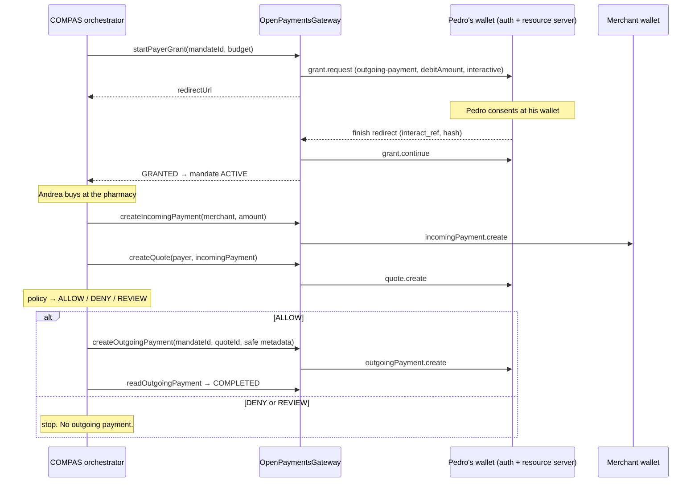

# Plan — Open Payments integration

Status: proposed, 2026-10-16. Owner: the Open Payments feature team.

This feature builds the real Open Payments layer that the COMPAS backend will call to run a payment end to end. The orchestrator, the category and purpose policy, the merchant registry and the HTTP API for the surfaces are other features. They are out of scope here. This plan does stop at a clear handoff contract so the orchestrator can plug in without reopening this work.

Read [04-open-payments-mapping.md](../04-open-payments-mapping.md) first. It says who enforces what. This plan says how to build the Open Payments half.

## Goal

When this feature is done, a backend caller can do the following against the Interledger test network, using only `OpenPaymentsGateway`:

1. Ask Pedro to consent to a capped outgoing-payment grant on his wallet, with no receiver yet.
2. Finish that consent after the redirect and keep the grant server-side.
3. Create an incoming payment on the merchant's wallet.
4. Quote Pedro's wallet into that incoming payment.
5. Create the outgoing payment from the quote, but only when the caller already holds an `ALLOW`.
6. Read the payment until it is completed or failed.
7. Cancel the grant when a mandate is revoked or expires.

A smoke script proves steps 1 to 6 with real test wallets before the orchestrator exists. That script is our first evidence for the eligibility rule "real Open Payments integration".

## Out of scope

- Mandate lifecycle, purpose policy, line items, the merchant registry and the AI classifier.
- HTTP routes for mandates, purchase intents and payments. Those belong to the orchestrator. The one exception is the GNAP finish callback, which is pure protocol (Phase 4).
- Frontend surfaces. ARQ, Nequi and Nequi Negocios stay simulations.
- Split tender, payer exception grants (`limits.receiver`) and NFC. They are on the scope ladder in `.skills/compas-context`. The port shape below leaves room for them.

## What we use from Open Payments

Everything comes from `@interledger/open-payments` 7.4.0, the current `latest` on npm, published 2026-10-07. The signatures below were read from that package's `.d.ts` files.

| Need | SDK call | Grant / auth |
| --- | --- | --- |
| Signed client for COMPAS | `createAuthenticatedClient({ walletAddressUrl, keyId, privateKey })` | Ed25519 key registered on COMPAS's client wallet |
| Discover auth and resource servers | `client.walletAddress.get({ url })` | none |
| Payer consent | `client.grant.request({ url: authServer }, { access_token: { access: [{ type: "outgoing-payment", actions: ["create", "read"], identifier: payerWallet, limits: { debitAmount, interval? } }] }, interact: { start: ["redirect"], finish: { method: "redirect", uri, nonce } } })` | interactive. Returns `PendingGrant` with `interact.redirect`, `interact.finish` and `continue` |
| Finish consent | `client.grant.continue({ url: continue.uri, accessToken: continue.access_token.value }, { interact_ref })` and `isFinalizedGrantWithAccessToken` | continuation token |
| Merchant charge | `client.incomingPayment.create({ url: resourceServer, accessToken }, { walletAddress, incomingAmount, expiresAt?, metadata? })` | non-interactive `incoming-payment` grant on the merchant's auth server |
| Price the payment | `client.quote.create({ url: resourceServer, accessToken }, { walletAddress, receiver, method: "ilp" })` | non-interactive `quote` grant on the payer's auth server |
| Pay | `client.outgoingPayment.create({ url: resourceServer, accessToken }, { walletAddress, quoteId, metadata })` | the payer's outgoing-payment grant token |
| Watch the payment | `client.outgoingPayment.get({ url, accessToken })` | same token |
| Remaining grant capacity | `client.outgoingPayment.getGrantSpentAmounts({ url, accessToken })` | same token. Verify the test network supports it. |
| Keep a long-lived grant usable | `client.token.rotate({ url: manage, accessToken })` | the grant's access token |
| Revoke | `client.grant.cancel({ url: continue.uri, accessToken })` | continuation token |
| Error shape | `OpenPaymentsClientError` (`status`, `code`, `description`, `validationErrors`) | |

Facts this plan depends on:

- Outgoing-payment grant limits are `receiver`, `interval` and **either** `debitAmount` **or** `receiveAmount`. Nothing else. Purpose stays in COMPAS.
- An outgoing payment is created from a `quoteId`, or directly from `incomingPayment` + `debitAmount`. We use the quote path because the demo needs a visible quote.
- An outgoing payment has no `status` field. It has `failed`, `debitAmount`, `receiveAmount` and `sentAmount`. We derive `PENDING | COMPLETED | FAILED` ourselves. The current port's `status: string` is wrong and gets replaced.
- Every authenticated call needs an access token. The current port carries no token anywhere, so it cannot be implemented as written. Phase 1 fixes this.
- The finish redirect returns `interact_ref` and `hash`. The hash must be checked against our nonce, the auth server's `finish` value, `interact_ref` and the grant endpoint URL before we call `grant.continue`. Confirm the exact hash input and encoding against openpayments.dev before coding it.
- The SDK ships as CommonJS. The backend is ESM and runs with `--experimental-strip-types`. Phase 0 checks that named imports work. Under strip-types we can't use TS `enum` or constructor parameter properties.

## Wallets and identities

| Role | Wallet address | Notes |
| --- | --- | --- |
| COMPAS client | `CLIENT_WALLET_ADDRESS` | Our identity as an Open Payments client. Its key signs every request. Its balance is never touched. A separate wallet keeps the non-custodial story obvious in the demo. |
| Payer (Pedro) | `DEMO_PAYER_WALLET_ADDRESS` | USD test wallet. Pedro consents here. Money leaves from here. |
| Merchant (Droguería Central) | `DEMO_MERCHANT_WALLET_ADDRESS` | Receives the incoming payment. A different asset makes the quote meaningful. Any cross-currency figure comes from the quote, never a hardcoded rate. |
| Delegate (Andrea) | none | Andrea is outside Open Payments. She never gets a wallet role or a token. |

All three wallets come from the Interledger test wallet. In production the merchant's own wallet provider would create the incoming payment. In the demo COMPAS creates it as a client with a non-interactive grant. That is a real Open Payments call, not a simulation, and the docs should say who did it.

## Target layout

Everything stays inside `backend/`, behind the existing port. Only files under `backend/src/integrations/open-payments/` import the SDK.

```text
backend/
  .env.example                                  + DEMO_*_WALLET_ADDRESS, OPEN_PAYMENTS_FINISH_URI
  scripts/
    op-smoke.ts                                 end-to-end run on the test network (Phase 3)
  src/
    ports/
      open-payments-gateway.ts                  revised port (Phase 1)
      grant-store.ts                            new port: grant secrets keyed by COMPAS id
    integrations/open-payments/
      config.ts                                 read and validate env, load the private key
      sdk-client.ts                             the only createAuthenticatedClient call
      interledger-open-payments-gateway.ts      real adapter
      interaction-hash.ts                       GNAP finish-hash check
      mappers.ts                                SDK amounts and payments -> domain types, status derivation
      errors.ts                                 OpenPaymentsClientError -> OpenPaymentsGatewayError
      in-memory-grant-store.ts                  MVP GrantStore
      unimplemented-open-payments-gateway.ts    kept. Used when env is missing.
    api/
      server.ts                                 + GET /open-payments/finish (Phase 4)
  tests/
    integrations/open-payments/
      interaction-hash.test.ts
      mappers.test.ts
      gateway.test.ts                           SDK test double, no network
contracts/
  open-payments/README.md                       payloads the frontend will see (Phase 4)
```

## Port redesign (Phase 1)

The port keeps COMPAS words on its surface. Access tokens, continuation tokens and nonces never leave the adapter. The caller refers to a grant by `grantKey`, the COMPAS mandate id.

```ts
export type PaymentState = "PENDING" | "COMPLETED" | "FAILED";

export interface OpenPaymentsGateway {
  resolveWallet(walletAddressUrl: string): Promise<WalletAddressInfo>;

  /** Interactive. Returns where to send the payer. No receiver is set. */
  startPayerGrant(input: {
    grantKey: string;              // compasMandateId
    payerWalletAddressUrl: string;
    debitLimit: MoneyAmount;       // mandate budget
    interval?: string;             // ISO 8601 repeating interval
  }): Promise<{ redirectUrl: string }>;

  /** Checks the finish hash, continues the grant, stores the token. */
  finishPayerGrant(input: {
    grantKey: string;
    interactRef: string;
    hash: string;
  }): Promise<{ status: "GRANTED" }>;

  cancelPayerGrant(grantKey: string): Promise<void>;

  createIncomingPayment(input: {
    merchantWalletAddressUrl: string;
    incomingAmount: MoneyAmount;
    expiresAt?: string;
    metadata?: SafePaymentMetadata;
  }): Promise<IncomingPaymentRef>;

  createQuote(input: {
    payerWalletAddressUrl: string;
    incomingPaymentUrl: string;
  }): Promise<QuoteRef>;           // id, debitAmount, receiveAmount, expiresAt

  /** Callers reach this only through createOutgoingPaymentIfAllowed. */
  createOutgoingPayment(input: {
    grantKey: string;
    payerWalletAddressUrl: string;
    quoteId: string;
    metadata: SafePaymentMetadata; // compasMandateId, compasDecisionId, externalReference only
  }): Promise<OutgoingPaymentRef>; // url, state, debitAmount, sentAmount

  readOutgoingPayment(input: {
    grantKey: string;
    outgoingPaymentUrl: string;
  }): Promise<OutgoingPaymentRef>;

  readGrantSpentAmounts(grantKey: string): Promise<{ spentDebitAmount?: MoneyAmount }>;
}
```

`GrantStore` holds, per `grantKey`: the pending state (continue URI and token, our nonce, the auth server's finish nonce, the grant endpoint) and then the finalized state (access token, manage URL, expiry). For the hackathon it lives in memory. A backend restart means Pedro consents again, and the docs say so. Tokens are never logged, never returned over HTTP and never written to `data/`.

`createOutgoingPaymentIfAllowed` keeps its gate and its test. Its input type follows the new port.

## Phases

Each phase is a mergeable PR that keeps `npm run typecheck` and `npm test` green.

### Phase 0 — Prerequisites (people, about 30 min)

- [ ] Create three test wallet accounts or addresses: COMPAS client, Pedro (USD) and the merchant. Fund Pedro's wallet with test money.
- [ ] Generate a developer key on the client wallet. Put `KEY_ID` and the key file path in `backend/.env`. `*.key` and `.env*` are already gitignored. Check with `git status` before every commit.
- [ ] `cd backend && npm install @interledger/open-payments@7.4.0`, pinned exactly.
- [ ] Check that `import { createAuthenticatedClient } from "@interledger/open-payments"` runs under `node --experimental-strip-types`. If named CJS exports fail, use a default import in `sdk-client.ts` only.
- [ ] Decide how `.env` loads: `process.loadEnvFile()` in `config.ts`, or `--env-file-if-exists=.env` in the npm scripts. No new dependency.
- [ ] Create the missing `AI_USAGE.md` at the repo root. `docs/08-hackathon-compliance.md` says it exists, and it doesn't.

### Phase 1 — Port, grant store, mappers (no network)

- [ ] Replace the port types as above. Update `UnimplementedOpenPaymentsGateway` and `createOutgoingPaymentIfAllowed` to match.
- [ ] Add the `GrantStore` port and `InMemoryGrantStore`.
- [ ] `mappers.ts`: SDK `amount` to `MoneyAmount` (same shape, validated). Outgoing payment to `PaymentState`: `failed` means `FAILED`, `sentAmount >= debitAmount` means `COMPLETED`, anything else is `PENDING`.
- [ ] `SafePaymentMetadata` is built through a whitelist function, so an extra key can't slip into Open Payments metadata.
- [ ] Tests: mappers, the metadata whitelist and the existing gate test.

### Phase 2 — Real adapter

- [ ] `config.ts` reads `CLIENT_WALLET_ADDRESS`, `KEY_ID`, `PRIVATE_KEY_PATH` and `OPEN_PAYMENTS_FINISH_URI`. If any is missing, the composition root uses `UnimplementedOpenPaymentsGateway`, which keeps throwing. It never falls back to a fake.
- [ ] `sdk-client.ts` builds a single `AuthenticatedClient`.
- [ ] `InterledgerOpenPaymentsGateway` implements every port method with the calls in the table above:
  - Payer grant: `outgoing-payment` access with `identifier` = payer wallet, `limits.debitAmount` = budget and no `receiver`. We generate the nonce with `crypto.randomUUID()` or random bytes.
  - Incoming payment and quote grants are non-interactive. Request them when needed and cache them per wallet until they expire.
  - Before `createOutgoingPayment`, re-quote if `expiresAt` has passed. Never reuse an expired quote.
  - Rotate the payer token when it has expired, then retry once.
- [ ] `errors.ts` maps `OpenPaymentsClientError` to typed codes such as `GRANT_PENDING`, `GRANT_LIMIT_EXCEEDED`, `QUOTE_EXPIRED`, `INSUFFICIENT_FUNDS`, `UNAUTHORIZED` and `UPSTREAM`. Unknown errors fail closed.
- [ ] `interaction-hash.ts` implements the hash check and gets a unit test.
- [ ] `gateway.test.ts` uses an injected SDK test double. It asserts the grant request has no `receiver`, that metadata has only safe keys, that tokens don't appear in returned values, and that a bad hash stops `grant.continue`. The SDK's `mock*` helpers may build fixtures. They are test doubles, not Open Payments responses.

### Phase 3 — Smoke script on the test network (eligibility proof)

- [ ] `backend/scripts/op-smoke.ts` plus `npm run op:smoke`. It drives the real gateway: resolve wallets, start the payer grant, print the redirect URL, wait for the pasted finish URL, finish the grant, create a USD 40 incoming payment on the merchant wallet, quote, create the outgoing payment with demo metadata ids, then poll until `COMPLETED`.
- [ ] Run it once with real test wallets. Record the outgoing-payment URL and the test wallet's transaction screen for the demo. Don't commit any token.
- [ ] Try `limits.interval` here (for example `R/<validFrom>/P1M`). If the test network rejects it, ship without an interval and enforce expiry in COMPAS with `cancelPayerGrant`.
- [ ] Try `readGrantSpentAmounts`. If it isn't supported, the orchestrator tracks `remainingAuthorizedAmount` from completed `debitAmount`s.

Merge this phase before the code freeze on Sat 17 Oct 2026 at 11:00, even if Phases 4 and 5 slip.

### Phase 4 — Finish callback and contracts

- [ ] `GET /open-payments/finish?grantKey=…&interact_ref=…&hash=…` in `api/server.ts`. It calls `finishPayerGrant`, then redirects the browser to a frontend URL such as `/demo?payerAuthorization=granted`. It returns no token or Open Payments payload. Moving the mandate from `PENDING_AUTHORIZATION` to `ACTIVE` is the orchestrator's job, done through an injected `onPayerGrantFinished(grantKey)` hook.
- [ ] `contracts/open-payments/README.md` defines the two shapes the frontend will see: `PayerAuthorizationStarted { redirectUrl }` and `PaymentReceipt { outgoingPaymentUrl, state, debitAmount, receiveAmount }`. No tokens.

### Phase 5 — Hardening, if time allows

- [ ] Idempotency: store the outgoing-payment URL by `compasDecisionId`. A retry with the same decision reads the existing payment instead of creating another one.
- [ ] `cancelPayerGrant` is wired for mandate revoke and expiry.
- [ ] Integration test in `backend/tests/integration/`: a denied intent through the application service never calls `createOutgoingPayment` on the real adapter type, as `tests/integration/README.md` asks.

### Phase 6 — Docs and compliance (alongside each phase)

- [ ] Update `docs/04-open-payments-mapping.md`, `.AGENTS/open-payments.md` and `backend/README.md` with the real flow and the new env names.
- [ ] Add the new env names to `backend/.env.example`, with empty values.
- [ ] Log each coding prompt in `prompts/NNN-*.md` and update `AI_USAGE.md`.

## Handoff to the orchestrator

The orchestrator will call the gateway in this order. Steps marked policy are not Open Payments.



Whether the quote comes before or after the policy decision is the orchestrator's call. Quoting first lets the decision use the real debit amount against `remainingAuthorizedAmount`. On the alcohol path an unused incoming payment and quote expire harmlessly. No money moves.

## Decisions for the team

1. **Grant interval.** Recommended: no interval for the MVP. The budget is then a lifetime cap, which matches "up to USD 40". COMPAS enforces expiry and cancels the grant. Revisit after the Phase 3 test.
2. **Grant persistence.** Recommended: in memory, behind `GrantStore`. A database is out of scope by `.AGENTS/development.md`.
3. **Who creates the incoming payment.** Recommended: COMPAS as a client in the demo. The pitch says that in production the merchant's wallet does it.
4. **Merchant asset.** Pick a non-USD test wallet asset only if the test network can quote USD into it. Otherwise use USD to USD and say so.

## Risks

| Risk | Mitigation |
| --- | --- |
| The test network is slow or down during the demo | Record the Phase 3 run as a backup video. Never swap in a fake success. |
| Hash or encoding mismatch on finish | Unit test against the documented algorithm. Check it in the smoke run. |
| An expired token mid-demo | Rotation in Phase 2. If rotation fails, ask Pedro to consent again. |
| A private key leaks | Key path only in `.env`, already gitignored. `config.ts` never logs values. |
| CJS/ESM interop under strip-types | Checked in Phase 0. Only `sdk-client.ts` touches the import. |
